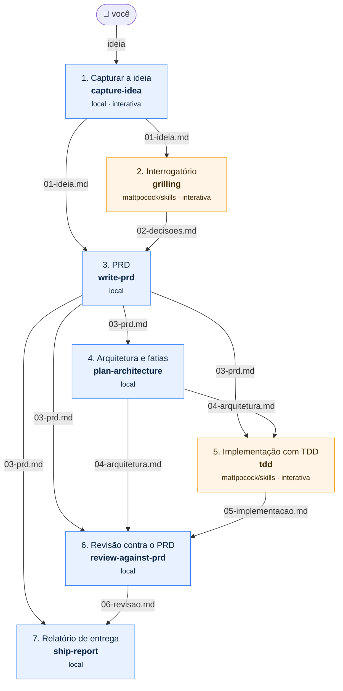

# agent-skills-pipeline

Um projeto feito **só de skills encadeadas**. Uma ideia solta entra, passa por sete etapas e sai como feature implementada com testes, revisada e documentada. Cada etapa é uma [Agent Skill](https://www.skills.sh/docs): umas escritas aqui, outras instaladas do [skills.sh](https://www.skills.sh/).

O objetivo é deixar **visível** como várias skills trabalham juntas:

- **qual** skill roda em cada etapa → [`flow.yaml`](flow.yaml)
- **o que** cada uma recebeu e entregou → os arquivos em `docs/flow/`
- **em que ponto** você está → `npm run status`
- **se o fluxo está consistente** → `npm run validate`

Funciona com **Claude Code**, **Codex** e qualquer agente compatível com o padrão Agent Skills. No ChatGPT e no Claude.ai web também dá para usar, de forma manual ([veja como](docs/guias/usar-com-claude-e-chatgpt.md)).

## O fluxo

<!-- pipeline:diagram:start -->

<!-- pipeline:diagram:end -->

Azul = skill escrita neste repositório (`skills/`). Laranja = skill externa do skills.sh, encaixada com um *adapter* (`adapters/`). Cada seta é um **arquivo**: as skills nunca conversam entre si, só leem o que a etapa anterior gravou.

| # | Etapa | Skill | Origem | Lê | Grava |
|---|-------|-------|--------|----|-------|
| 1 | Capturar a ideia | `capture-idea` | local | sua mensagem | `01-ideia.md` |
| 2 | Interrogatório | `grilling` | [mattpocock/skills](https://www.skills.sh/mattpocock/skills/grilling) | 01 | `02-decisoes.md` |
| 3 | PRD | `write-prd` | local | 01, 02 | `03-prd.md` |
| 4 | Arquitetura e fatias | `plan-architecture` | local | 03 | `04-arquitetura.md` |
| 5 | Implementação com TDD | `tdd` | [mattpocock/skills](https://www.skills.sh/mattpocock/skills/tdd) | 03, 04 | `05-implementacao.md` + código em `workspace/` |
| 6 | Revisão contra o PRD | `review-against-prd` | local | 03, 04, 05 | `06-revisao.md` |
| 7 | Relatório de entrega | `ship-report` | local | 03, 06 | `07-entrega.md` |

Acima de todas está o **maestro**, `run-pipeline`: uma skill que não faz o trabalho de nenhuma etapa. Ela pergunta ao `npm run status` qual etapa vem agora, chama a skill certa e confere se o arquivo de saída apareceu.

Quer ver uma execução completa? [`examples/contador-de-palavras/`](examples/contador-de-palavras/) tem os 7 artefatos e o código que saiu no fim.

## Começando

Requisitos: Node **22.18+**. Os scripts são TypeScript rodando direto no Node, sem build.

```bash
npm install
```

```bash
npm run setup
```

O `setup` usa o CLI oficial do skills.sh (`npx skills add`) para instalar as skills externas do [`skills.json`](skills.json) e as locais de `skills/` em `.claude/skills/` (Claude Code) e `.agents/skills/` (Codex e outros).

```bash
npm run validate
```

Depois abra o agente nesta pasta e diga:

> Rode o pipeline. Minha ideia: um comando que conta as palavras de um texto e mostra as mais repetidas.

O agente vai rodar **uma etapa por vez** e parar entre elas para você ler o arquivo gerado. As etapas 1, 2 e 5 são interativas: ele vai te fazer perguntas. A qualquer momento:

```bash
npm run status
```

```
ideia-ate-feature

  ✔ idea          capture-idea        pronta        docs/flow/01-ideia.md
  ✔ grill         grilling            pronta        docs/flow/02-decisoes.md
  ▶ prd           write-prd           pode rodar    vai gravar docs/flow/03-prd.md ← próxima
  · architecture  plan-architecture   bloqueada     falta docs/flow/03-prd.md
  ...
```

Quando terminar, `npm run archive` move a execução para `docs/runs/<data>-<ideia>/` e libera `docs/flow/` para a próxima ideia.

## Comandos

| Comando | O que faz |
|---------|-----------|
| `npm run setup` | Instala skills externas + locais para os agentes do `skills.json` (`-- --dry-run` só mostra os comandos) |
| `npm run validate` | Confere se o fluxo fecha: skills existem, entradas vêm de etapas anteriores, cada arquivo tem um dono, instalação em dia |
| `npm run status` | Em que etapa você está (`-- --json` para agentes, `-- --dir <pasta>` para outra execução) |
| `npm run new-skill -- <nome> "<descrição>"` | Cria `skills/<nome>/SKILL.md` no formato do pipeline |
| `npm run diagram -- --write` | Regenera o diagrama deste README a partir do `flow.yaml` |
| `npm run archive` | Move a execução atual para `docs/runs/` |
| `npm run check` | Typecheck + testes + validate |

## Estrutura

```
agent-skills-pipeline/
├── flow.yaml                  # O FLUXO: ordem, skill, entradas e saídas de cada etapa
├── skills.json                # skills externas (owner/repo do skills.sh) + agentes alvo
├── skills-lock.json           # gerado pelo CLI skills: versões exatas instaladas
├── skills/                    # skills escritas aqui (padrão Agent Skills)
│   ├── run-pipeline/          #   o maestro
│   │   ├── SKILL.md
│   │   └── references/contrato-dos-artefatos.md
│   ├── capture-idea/          #   cada etapa: SKILL.md + template.md do artefato
│   ├── write-prd/
│   ├── plan-architecture/
│   ├── review-against-prd/
│   └── ship-report/
├── adapters/                  # encaixe das skills externas no fluxo
│   ├── grilling.md
│   └── tdd.md
├── docs/
│   ├── flow/                  # os bastões da execução atual (01-ideia.md … 07-entrega.md)
│   ├── runs/                  # execuções arquivadas
│   └── guias/                 # documentação detalhada
├── workspace/                 # código gerado pela etapa 5 (fora do git)
├── examples/contador-de-palavras/  # uma execução completa, para consulta
├── scripts/                   # validate, status, setup, new-skill, diagram, archive
│   └── lib/                   # lógica pura (testada em test/)
├── AGENTS.md / CLAUDE.md      # instruções do repositório para Codex / Claude Code
└── test/
```

## Guias

1. [Como o fluxo funciona](docs/guias/como-funciona.md): skills, artefatos, estados, o maestro e os adapters
2. [Adicionar uma skill](docs/guias/adicionar-skills.md): do skills.sh ou escrita por você
3. [Montar o seu próprio fluxo](docs/guias/montar-seu-fluxo.md): trocar, reordenar e criar etapas, ou levar o modelo para outro projeto
4. [Usar com Claude e ChatGPT](docs/guias/usar-com-claude-e-chatgpt.md): Claude Code, Claude.ai, Codex e ChatGPT web

## Sobre as skills externas

As skills de terceiros rodam com as mesmas permissões do seu agente. Leia o `SKILL.md` de cada uma antes de adicioná-la ao `skills.json` (o skills.sh tem uma página de [auditorias de segurança](https://www.skills.sh/audits)). O `npm run setup` desliga a telemetria do CLI por padrão; use `DISABLE_TELEMETRY=0 npm run setup` se quiser contar no ranking do skills.sh.
